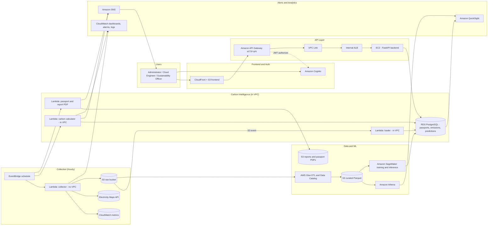

# AI-Powered Cloud Digital Carbon Passport Framework — AWS Deployment Guide

**Project:** AI-Powered Cloud Digital Carbon Passport Framework for Sustainable IT Infrastructure using Green AI and Carbon Intelligence Analytics
**Repository:** `CloudCarbonPassport_Cloud_Project_2026`
**Source of truth:** `Cloud_review_1.docx` (Review-1 report, Sections 1–13, Figures 7.1 and 8.1)
**Target audience:** A human student team *or* an AI coding/deployment agent that must build and deploy this project on AWS with minimal guesswork.

---

## 0. How to Use This Guide (Read First)

1. **Section 1–3** tell you what the system is and what is still undecided. Resolve the items in Section 3 before you create any AWS resource.
2. **Section 4** maps every component to an AWS service. **Section 5** explains every relevant AWS service, including ones the report does not list.
3. **Section 7–9** are the build contract: naming, configuration, network, and the ordered deployment phases.
4. **Section 10** is the test plan. **Section 11** is the cost guardrail. **Section 12** is teardown.
5. **Agent rules (Section 0.1)** apply if an AI is doing the deployment.

### 0.1 Rules for an AI Deployment Agent

- **Do not create billable "always-on" resources until their phase is reached**: NAT Gateway, Application Load Balancer, RDS, EC2, SageMaker endpoints, QuickSight subscription. Each one is listed in Section 11 with its phase.
- **Ask the human before** creating: a NAT Gateway, a QuickSight subscription (it has per-user fees), a SageMaker real-time endpoint, or any resource in a second region.
- **Tag every resource** with the tags in Section 7.3. Untagged resources make teardown and cost tracking unreliable.
- **Be idempotent.** Check whether a resource exists before creating it. Record every ID/ARN/URL in `deploy/outputs.env` (never commit secrets).
- **Never hardcode** account IDs, secrets, API tokens, or region-specific ARNs in source code. Read them from configuration (Section 7.2).
- **Do not invent data.** If the real dataset is missing, use the synthetic generator described in Phase 3 and label every result as synthetic in the report.
- After each phase, run that phase's check in Section 10 before continuing.

---

## 1. Project Summary

### 1.1 What the system does

| Capability | Description | Source in report |
|---|---|---|
| Resource monitoring | Collect CPU, memory, storage, network, runtime, and power-related metrics from AWS resources | Sec. 8 |
| Carbon estimation | Convert utilization into energy (kWh) and emissions (kgCO₂e) using grid carbon intensity | Sec. 8 |
| Digital Carbon Passport | One passport record (and PDF) per cloud resource, updated over time | Sec. 6, 8 |
| Green AI prediction | ML model forecasts future emissions and flags inefficient resources | Sec. 8 |
| Recommendations | Right-size, shut down idle resources, shift to greener regions, schedule, remove waste | Sec. 8 |
| Alerts and reports | Email alerts on thresholds; monthly carbon and ESG reports | Sec. 8, Fig. 8.1 |
| Dashboard | Live carbon metrics, sustainability score, rankings, trends | Sec. 8, Fig. 8.1 |
| Access control | Login for administrators, cloud engineers, sustainability officers | Sec. 10 |

### 1.2 Definition of "done" for this project

The deployment is complete when all of the following are true:

1. A user can sign in (Cognito), call the REST API (API Gateway → EC2), and receive resource and passport data.
2. At least one AWS resource in the account has a passport with computed emissions for the last 7 days.
3. A scheduled job (EventBridge) runs the collection and calculation without manual action.
4. A trained model (SageMaker) produces a forecast for each monitored resource, stored in the database.
5. A threshold breach sends an email through SNS.
6. A monthly PDF report is written to S3 and its link is emailed.
7. The dashboard (QuickSight or the chosen frontend) shows the same numbers as the API.
8. Everything is tagged, budgeted, and can be torn down with the steps in Section 12.

---

## 2. What Was Analysed

The uploaded folder contains **one file**: the Review-1 report (`Cloud_review_1.docx`). It has:

- Sections 1–13 (abstract, problem, literature table, research gap, objectives, novelty, two architecture figures, dataset, AWS service plan, GitHub structure and workflow, references).
- Two architecture diagrams (Figure 7.1 AWS reference architecture with seven layers; Figure 8.1 end-to-end system workflow).
- **No source code, no dataset files, no infrastructure code.** The repository tree in Section 11 is a plan, not an existing project.

Consequently, this guide is a **design-to-deployment specification** built from the report. Where the report is silent or inconsistent, Section 3 lists the gap and the default this guide assumes.

---

## 3. Gaps, Inconsistencies, and Decisions Required

Resolve these first. The "Default" column is what the rest of this guide assumes if nobody decides otherwise.

| # | Issue | Where | Default assumed by this guide |
|---|---|---|---|
| G1 | Backend stack is written as "FastAPI / Node.js" | Fig. 7.1 | **FastAPI (Python)**, because the ML, Glue, and Lambda code is also Python |
| G2 | No frontend hosting service is named, though `src/frontend/` exists | Sec. 11 | **S3 + CloudFront** for a static frontend, or Amplify Hosting if the team prefers managed CI/CD |
| G3 | Two dashboards appear: QuickSight (Sec. 10) and a "Sustainability Dashboard" (Fig. 8.1) | Sec. 10, Fig. 8.1 | **QuickSight** for analytics, plus a small custom page for passports and recommendations. If the budget is tight, use only the custom page |
| G4 | Fig. 7.1 shows ECS under "AWS Cloud Infrastructure", but ECS is never used by the framework | Fig. 7.1 | ECS is treated as a **monitored resource type** only (the system must be able to measure it). It is not deployed by this project |
| G5 | "Real-time" monitoring is claimed, but Fig. 8.1 says "Daily Schedule" | Sec. 1, Fig. 7.1 | Metrics collected **hourly**; predictions and reports run **daily / monthly**. State this in the report |
| G6 | The sustainability score is never defined | Sec. 6, 8 | Proposed formula in Section 6.4, marked as **a proposal requiring team approval** |
| G7 | How carbon intensity is obtained is not stated (API vs. CSV download) | Sec. 9 | **Electricity Maps API** for live data, token stored in SSM Parameter Store. Check current API terms and whether historical data is paid |
| G8 | "Cloud Carbon Footprint Open Dataset" is cited as a dataset. It is actually an open-source **methodology and tool** | Sec. 9 | Use its **published coefficients** (power per vCPU, memory and storage factors, PUE) as the calculation model |
| G9 | The "combined dataset" has no join keys, and "Kaggle Cloud Resource Utilization Dataset" is not specified | Sec. 9 | Choose one specific Kaggle dataset and document the join. If no real joinable dataset exists, generate **synthetic telemetry** and state that in the report |
| G10 | No ground-truth emissions exist, so "improves prediction accuracy" cannot be shown | Sec. 5, 6 | Define an evaluation: MAE and MAPE on a held-out time window, compared with a naive baseline (last value) |
| G11 | Literature survey table (Sec. 3): all 15 rows contain identical text and are not tied to specific papers | Sec. 3 | Rewrite each row from its own paper before submission (documentation issue, not a deployment blocker) |
| G12 | Leftover template text ("Format these in IEEE style if your department requires it"); figure labels read "Figure 1" on both images but "7.1" and "8.1" in the captions | Sec. 13, Fig. labels | Clean up before submission |
| G13 | No region is chosen | — | **`ap-south-1` (Mumbai)** is the default for an India-based team. Confirm that every required service (SageMaker, QuickSight, Glue, Athena) is available there. Record the region in `deploy/config.env` |
| G14 | No cost ceiling | — | **Monthly budget of a fixed amount chosen by the team**, with alerts at 50%, 80%, and 100% (Phase 0) |
| G15 | Lambda functions that call external APIs need internet access, which can force an expensive NAT Gateway | Architecture | Use the **Lambda placement rule** in Section 8.3 |

### 3.1 Decisions the team must record

Write each decision into `docs/Decisions.md` (or the report) with a date:

- D1 Backend language and framework (default FastAPI)
- D2 Region (default `ap-south-1`)
- D3 Dashboard approach (QuickSight, custom page, or both)
- D4 Carbon intensity source and whether historical data is needed
- D5 Dataset(s) and join method, or synthetic-data decision
- D6 Sustainability score formula (Section 6.4)
- D7 Whether the API lives behind an ALB (recommended) or is simplified
- D8 SageMaker serving mode (serverless endpoint, batch transform, or training only)

---

## 4. Target Architecture

### 4.1 Logical flow (Figure 7.1 and Figure 8.1 combined)



### 4.2 Layer summary (matches the report's seven layers)

| Layer (Fig. 7.1) | Components | Services |
|---|---|---|
| 1. User | Administrator, Cloud Engineer, Sustainability Officer | Cognito user groups |
| 2. API | Authentication, REST endpoints, permissions | Cognito, API Gateway, IAM |
| 3. Application | Backend, carbon calculation, scheduling, ETL | EC2, Lambda, EventBridge, Glue |
| 4. AI Processing | Prediction, recommendations | SageMaker |
| 5. Database and Storage | Passport DB, datasets, reports, PDFs | RDS, S3 |
| 6. Analytics | Dashboard, sustainability analytics | QuickSight, Athena |
| 7. Monitoring and Notification | Alerts, metrics, logs | SNS, CloudWatch |

---

## 5. AWS Services Reference

### 5.1 Services the report plans (all 15)

| Service | Used for in this project | Specific responsibilities | Deployment notes |
|---|---|---|---|
| **Amazon EC2** | Hosts the FastAPI backend (report Sec. 10) | REST logic, passport queries, JWT verification, report triggers | `t3.micro` or `t4g.micro` (check Free Tier eligibility). Run under systemd or Docker. Access via SSM Session Manager, not open SSH |
| **Amazon API Gateway** | Public REST front door (Sec. 10) | Routes, JWT authorizer with Cognito, throttling, usage plans | HTTP API is simpler and cheaper. REST API is needed only for API keys, usage plans, or request validation |
| **Amazon Cognito** | Login for administrators, engineers, and officers (Sec. 10) | User pool, app client, hosted UI, groups (`admin`, `cloud_engineer`, `sustainability_officer`) | Use Cognito groups to drive role checks in the backend |
| **AWS IAM** | Permissions for every service (Sec. 10) | Execution roles for Lambda, EC2 instance profile, Glue, SageMaker, QuickSight | Least privilege per role. Never use root or access keys on EC2 |
| **Amazon RDS (PostgreSQL)** | Passports, users, predictions, reports (Sec. 10) | Relational store for passport records, emissions time series, recommendations | `db.t4g.micro`, 20 GB gp3, encrypted, private subnet, not publicly accessible, automated backups |
| **Amazon S3** | Datasets, reports, passport PDFs, logs (Sec. 10) | Raw telemetry, curated Parquet, model artifacts, PDFs, exports | Block public access. Lifecycle rules: raw data to Infrequent Access after 30 days, expire after 90–365 days |
| **AWS Lambda** | Carbon calculations and event-driven processing (Sec. 10) | Collector, loader, calculator, recommender, PDF generator, alert publisher | Python 3.12. Keep functions small, one job each. Set memory and timeout explicitly |
| **Amazon SageMaker** | Train and serve the carbon prediction model (Sec. 10) | Training job on curated data, model artifact in S3, inference | Do not run a real-time endpoint 24/7 for a student project. See Section 8, Phase 8 |
| **Amazon CloudWatch** | Metric source, app health, logs (Sec. 10) | Read utilization metrics of monitored resources; store Lambda and API logs; alarms; dashboards | Memory metrics need the CloudWatch agent on EC2. Default EC2 metrics are 5-minute |
| **Amazon SNS** | Threshold alerts and report notifications (Sec. 10) | Topic `ccp-<env>-alerts`, email subscriptions | Email subscribers must confirm the subscription |
| **Amazon QuickSight** | Dashboards and reports (Sec. 10) | Datasets from Athena (curated S3) or RDS; SPICE refresh | Requires a QuickSight subscription and per-user seats. Check the cost before enabling (Section 11) |
| **AWS Glue** | Cleans and prepares data before training (Sec. 10) | ETL job raw → curated Parquet; Data Catalog; crawler for Athena | Use the smallest worker configuration. Glue Spark jobs have a per-job minimum billing |
| **Amazon Athena** | SQL over S3 datasets (Sec. 10) | Ad hoc analysis, QuickSight source, validation queries | Store data as Parquet and partition by date and region to reduce bytes scanned (you pay per data scanned). Set a workgroup scan limit |
| **Amazon EventBridge** | Scheduled monitoring, predictions, reports (Sec. 10) | `rate(1 hour)` collector; daily prediction; monthly report `cron(0 2 1 * ? *)` | Scheduled rules are cheap. Use one rule per job so each can be disabled separately |

### 5.2 Additional AWS services relevant to this project

These are **not** in the report. Each is marked **Recommended**, **Optional**, or **Not needed**.

| Service | Category | Use in this project | Status |
|---|---|---|---|
| **AWS Systems Manager Parameter Store** | Config and secrets | Store the Electricity Maps token and non-secret config (cheaper than Secrets Manager for this) | **Recommended** |
| **AWS Secrets Manager** | Secrets | Database password (`--manage-master-user-password` on RDS creates one) | **Recommended** (small fee per secret) |
| **AWS Systems Manager Session Manager** | Ops | Shell into EC2 without opening port 22 | **Recommended** |
| **AWS KMS** | Security | Encryption keys for S3, RDS, and SNS (default AWS-managed keys are sufficient) | **Recommended** (default) |
| **Amazon VPC** | Networking | Isolates RDS, EC2, ALB, and in-VPC Lambdas | **Required** |
| **Application Load Balancer** | Networking | Between VPC Link and EC2 targets, with health checks | **Recommended** (adds an hourly cost) |
| **AWS VPC Link** | Networking | Connects API Gateway privately to the ALB | **Required** if the ALB is used |
| **NAT Gateway** | Networking | Internet egress for private subnets | **Avoid** for this project. It is a common surprise cost (Section 8.3) |
| **VPC Gateway Endpoint for S3** | Networking | Free private route from VPC resources to S3 | **Recommended** |
| **Amazon CloudFront** | Frontend | Serves the static frontend over HTTPS | **Recommended** |
| **Amazon Route 53** | DNS | Custom domain for the API and dashboard | Optional |
| **AWS Certificate Manager (ACM)** | TLS | Certificates for CloudFront and the custom domain | Optional |
| **AWS WAF** | Security | Rate-limit or block bad traffic on API Gateway or CloudFront | Optional (adds cost) |
| **Amazon SQS** | Messaging | Queue between collector and loader for retries and decoupling | **Recommended** (low cost) |
| **AWS Step Functions** | Orchestration | Monthly pipeline: Glue → SageMaker → passport refresh → report → SNS | **Recommended** for reliability and visibility |
| **Amazon SES** | Email | Branded HTML report emails (SNS is simpler for plain alerts). SES starts in sandbox mode and needs verified addresses | Optional |
| **Amazon DynamoDB** | Database | Alternative store for passport documents or alert state. Not needed if RDS is used | Optional |
| **Amazon ElastiCache** | Caching | Caches dashboard summary queries | Not needed at this scale |
| **Amazon Kinesis Data Streams / Firehose** | Streaming | Real-time telemetry ingestion at high volume | Not needed (hourly batch is sufficient). Mention as a scaling path |
| **Amazon EMR / Redshift** | Big data and warehouse | Large-scale Spark or warehousing | Not needed |
| **AWS Lake Formation** | Governance | Fine-grained access to the data lake | Not needed |
| **Amazon OpenSearch Service** | Search and logs | Searching logs or passports at scale | Not needed |
| **Amazon Bedrock** | Generative AI | Optional: write plain-English summaries of recommendations. Adds token cost and a dependency | Optional (keep recommendations rule-based in the core build) |
| **AWS Cost Explorer** | Cost | Cost data to compare cost vs. carbon per resource | Optional (per-request fee) |
| **AWS Budgets** | Cost guardrail | Monthly budget and alerts | **Recommended** (Phase 0) |
| **AWS Customer Carbon Footprint Tool** | Carbon | Official AWS emissions figures for the account (in the Billing console). Use to **validate** the project's estimates | **Recommended** for validation. Reports are monthly and lag |
| **AWS Compute Optimizer** | Optimization | Right-sizing suggestions. Use as a cross-check for the project's own recommendations | Optional |
| **AWS Resource Groups Tagging API** | Inventory | Finds all tagged resources to monitor across services | **Recommended** |
| **AWS Trusted Advisor** | Best practice | Basic checks such as idle resources and public buckets | Optional |
| **AWS CloudTrail** | Audit | Records API activity. Event history is on by default | **Recommended** (default) |
| **AWS Config** | Compliance | Checks resource configuration rules | Optional |
| **AWS Organizations** | Accounts | Separate dev and prod accounts | Optional |
| **AWS Service Quotas** | Limits | Check quotas before deploying (e.g., SageMaker instance types on new accounts) | **Recommended** |
| **AWS CloudFormation / AWS CDK / Terraform** | IaC | Reproducible deployment of this guide | **Recommended**. Terraform is used in the examples in Section 9 |
| **Amazon ECR** | Containers | Stores the backend Docker image if containers are used | Optional (needed if EC2 runs Docker from ECR) |
| **AWS CodeBuild / CodePipeline / CodeDeploy** | CI/CD | Automates deploying backend and Lambda code | Optional. GitHub Actions can do the same |
| **AWS Amplify Hosting** | Frontend | Managed hosting with CI/CD from GitHub | Optional (alternative to S3 + CloudFront) |
| **Amazon ECS / AWS Fargate** | Containers | Alternative to EC2 for the backend; also a monitored resource type in Fig. 7.1 | Optional. Mention as the scale-up path |
| **AWS Elastic Beanstalk / App Runner** | PaaS | Simpler alternatives to EC2 for the backend | Optional |
| **AWS Lambda Function URLs** | Serverless | Direct HTTPS access to a Lambda (not needed when API Gateway is used) | Not needed |

---

## 6. Carbon Calculation Specification

The calculation must be implemented in one module (`src/backend/carbon/`) and unit-tested. The formulas below follow the approach of the open-source Cloud Carbon Footprint methodology.

### 6.1 Inputs per resource per hour

| Input | Source | Notes |
|---|---|---|
| `cpu_avg_pct` | CloudWatch `CPUUtilization` (`AWS/EC2`, `AWS/RDS`) | Average over the hour |
| `vcpus` | EC2 instance type (`DescribeInstanceTypes`) | |
| `mem_gb` | EC2 instance type, or CloudWatch agent for used memory | |
| `storage_gb` | EBS volume size, RDS allocated storage, or S3 size | |
| `network_gb` | `NetworkIn` + `NetworkOut` | Optional term; include only if documented |
| `runtime_h` | Hours the resource was in the `running` state | From state history or the monitoring interval |
| `region` | Resource ARN or instance placement | |
| `grid_intensity_g_per_kwh` | Electricity Maps zone mapped from the AWS region | Store the region-to-zone mapping in config and document it |

### 6.2 Formulas

Per vCPU, power is interpolated between a minimum and maximum wattage:

```
watts_per_vcpu(u) = min_watts + (max_watts - min_watts) × (cpu_avg_pct / 100)
```

Compute energy for the hour:

```
energy_kwh = [ vcpus × watts_per_vcpu(u)  +  mem_gb × w_mem  +  storage_gb × w_storage ] / 1000 × PUE × runtime_h
```

Emissions:

```
emissions_kgco2e = energy_kwh × grid_intensity_g_per_kwh / 1000
```

- `min_watts`, `max_watts`, `w_mem`, `w_storage`, and `PUE` come from the published coefficient table of the Cloud Carbon Footprint project. **Fetch the current values from its repository and store them in a versioned config file** (`src/backend/carbon/coefficients.yaml`). Do not type them from memory. Record the version in the report.
- Use **location-based** emissions (grid intensity) as the primary method, and state this in the report.

### 6.3 Passport content (per resource, per period)

Each passport record stores:

- Identity: `passport_id`, `resource_id`, `resource_type`, `region`, `instance_type`, `tags`
- Period: `period_start`, `period_end`, `granularity` (hourly and daily values are both kept)
- Energy and carbon: `energy_kwh`, `carbon_intensity_g_per_kwh`, `emissions_kgco2e`
- Utilization stats: mean, p95, and max CPU; idle hours
- Score: `sustainability_score` (0–100) and its components
- Forecast: `forecast_next_7d_kgco2e`, `forecast_next_30d_kgco2e`, model version
- Recommendations: list of `{type, reason, estimated_saving_kgco2e, confidence}`
- Audit: `created_at`, `updated_at`, `version`, `calculation_version`

### 6.4 Sustainability score (proposed, requires decision D6)

A possible definition, to be agreed and written into the report:

```
score = 100 × ( 0.40 × efficiency + 0.30 × clean_grid + 0.30 × activity )

efficiency  = min(1, p95_cpu / target_cpu)                          # high use of a provisioned resource is good, up to the target
clean_grid  = 1 − clamp( grid_intensity / max_reference_intensity, 0, 1 )
activity    = 1 − idle_hours / total_hours
```

Document the `target_cpu` (for example 60%) and `max_reference_intensity` you choose. Keep the score in one function so it can be changed in one place.

### 6.5 Recommendation rules (rule-based core; ML adds forecasts)

| Rule | Condition (example thresholds, configurable) | Recommendation |
|---|---|---|
| Idle resource | CPU < 5% for 7 consecutive days | Stop or remove if non-production (tag-based) |
| Oversized | p95 CPU < 20% for 14 days | Right-size to the next smaller instance type |
| Greener region | Region intensity > candidate region intensity by 30%+, and workload is tagged movable | Consider migrating to the greener region |
| Off-hours schedule | Non-production tag and active outside working hours | Schedule stop and start |
| Storage waste | Unattached EBS volumes or S3 objects older than the retention policy | Delete or move to a cheaper class |
| Forecast breach | Forecast 30-day emissions exceed the threshold | Send alert via SNS |

---

## 7. Build Contract: Naming, Configuration, and Tags

### 7.1 Naming

- Prefix: `ccp` (Cloud Carbon Passport). Environment: `dev` or `prod`.
- Pattern: `ccp-<env>-<component>`, for example `ccp-dev-api`, `ccp-dev-db`, `ccp-dev-alerts`.
- S3 bucket names are globally unique, so add the account ID and region:
  `ccp-dev-<account_id>-<region>-raw`, `...-curated`, `...-reports`, `...-models`, `...-frontend`.
- Lambda: `ccp-<env>-collector`, `ccp-<env>-loader`, `ccp-<env>-calculator`, `ccp-<env>-pdf`, `ccp-<env>-alerter`.
- Glue job: `ccp-<env>-etl`. SageMaker training job names start with `ccp-<env>-forecast-`.

### 7.2 Configuration file (`deploy/config.env`, no secrets)

```bash
# deploy/config.env  (no secrets in this file)
PROJECT=ccp
ENV=dev
AWS_REGION=ap-south-1
AWS_ACCOUNT_ID=<fill>                     # never commit real values for prod
ALERT_EMAIL=<team-email>
MONTHLY_BUDGET_USD=<fill>
ELECTRICITY_MAPS_PARAM=/ccp/dev/electricitymaps/token   # SSM SecureString name
DB_NAME=carbon_passport
DB_INSTANCE_CLASS=db.t4g.micro
EC2_INSTANCE_TYPE=t3.micro
MONITOR_TAG_KEY=ccp:monitor
MONITOR_TAG_VALUE=true
COLLECT_SCHEDULE="rate(1 hour)"
PREDICT_SCHEDULE="cron(0 3 * * ? *)"     # daily 03:00 UTC
REPORT_SCHEDULE="cron(0 2 1 * ? *)"      # 1st of month 02:00 UTC
CARBON_ZONE_MAP_FILE=src/backend/carbon/region_zone_map.yaml
```

The backend and Lambdas read secrets from SSM Parameter Store at runtime. They read non-secret values from environment variables set by the deployment.

### 7.3 Tags (apply to every resource)

| Tag key | Example value | Purpose |
|---|---|---|
| `Project` | `CloudCarbonPassport` | Cost filtering |
| `Env` | `dev` | Environment separation |
| `Owner` | `team-student1` | Accountability |
| `ccp:monitor` | `true` | Marks a resource for carbon monitoring |
| `ccp:movable` | `true` / `false` | Whether the workload can be moved to another region (used by recommendations) |
| `ccp:lifecycle` | `production` / `non-production` | Used by idle and schedule rules |

Also tag the monitored demo workloads (for example, one small EC2 instance) so the system has real resources to measure.

### 7.4 Repository layout (matches report Sec. 11)

```
CloudCarbonPassport_Cloud_Project_2026/
├── README.md
├── docs/                      # abstract, objectives, datasets, AWS services, decisions
├── architecture/              # diagrams and this guide
├── dataset/
│   ├── raw/                   # not committed if large; document source and license
│   └── processed/
├── src/
│   ├── frontend/              # static SPA (served by S3 + CloudFront)
│   ├── backend/               # FastAPI app
│   │   ├── api/               # routes
│   │   ├── carbon/            # calculator, coefficients.yaml, region_zone_map.yaml
│   │   ├── passports/         # passport model and PDF generation
│   │   ├── recommend/         # rules
│   │   └── tests/
│   ├── ml_model/              # training, evaluation, inference code
│   └── aws/
│       ├── lambdas/           # collector, loader, calculator, pdf, alerter
│       ├── glue/             # ETL script
│       └── terraform/         # IaC (see Section 9)
├── deploy/
│   ├── config.env             # no secrets
│   ├── outputs.env            # written by deploy scripts (IDs, URLs), gitignored
│   └── teardown.md
├── results/
└── presentation/
```

---

## 8. Deployment Phases

Each phase lists **what to create**, **how**, and **the check** that must pass before moving on. Section 10 has the full test plan.

### Phase 0 — Account, Guardrails, and Access (do this first)

1. Use an AWS account with MFA on the root user. Do not use root for daily work.
2. Create an IAM Identity Center user (or an IAM user if Identity Center is not available) for the deploying person or agent. Give it a permission set scoped to this project where possible; administrator access is acceptable only for a personal student account.
3. Turn on **Billing alerts**, then create a **monthly budget** in AWS Budgets with notifications at 50%, 80%, and 100% of `MONTHLY_BUDGET_USD`.
   ```bash
   aws budgets create-budget --account-id "$AWS_ACCOUNT_ID" \
     --budget file://deploy/budget.json \
     --notifications-with-subscribers file://deploy/budget-notifications.json
   ```
4. Check your current Free Tier or credit status in the Billing console. AWS changed its Free Tier model in 2025, and terms differ by account. Do not assume any service is free; check Section 11.
5. Check **Service Quotas** for SageMaker training instance types and QuickSight in `ap-south-1`.
6. Install and configure the AWS CLI v2, and set `AWS_REGION` consistently.
7. Create the SSM parameter for the carbon intensity API token (SecureString), not in code:
   ```bash
   aws ssm put-parameter --name "/ccp/dev/electricitymaps/token" \
     --type SecureString --value "<token>" --region "$AWS_REGION"
   ```

**Check:** Budget exists and is active. Quotas are sufficient. CLI identity is the expected user (`aws sts get-caller-identity`).

### Phase 1 — Networking (VPC)

Create one VPC (`10.0.0.0/16`) with:

- Two **public** subnets (for EC2 and the public side of ALB) in two Availability Zones.
- Two **private** subnets (for RDS and the internal ALB) in the same two AZs.
- An **Internet Gateway** attached to the VPC. Route public subnets to it.
- **No NAT Gateway** (see Section 8.3 for why and for the alternative).
- **VPC Gateway Endpoint for S3** attached to the private route table. This is free and lets in-VPC Lambdas reach S3 without internet access.

Security groups:

| SG | Inbound | Source |
|---|---|---|
| `ccp-dev-sg-alb` | 443 (and 80 redirect if used) | VPC Link / API Gateway (use the VPC CIDR for an internal ALB) |
| `ccp-dev-sg-api` (EC2) | 8000 | `ccp-dev-sg-alb` only. **No port 22** |
| `ccp-dev-sg-db` (RDS) | 5432 | `ccp-dev-sg-api` and `ccp-dev-sg-lambda-vpc` only |
| `ccp-dev-sg-lambda-vpc` | None (egress only) | — |

Egress: allow all outbound from EC2 and the VPC Lambdas. Restrict if your policy requires it.

**Check:** `ccp-dev-sg-db` cannot be reached from outside the VPC (test with a connection from an unrelated subnet or a bastion-less timeout).

### Phase 2 — Storage (S3) and Database (RDS)

**S3 buckets** (create with block public access on, default encryption on, versioning on for `curated` and `reports`):

| Bucket | Contents | Lifecycle |
|---|---|---|
| `...-raw` | Collected metrics and intensity JSON/CSV, dataset uploads | Transition to Infrequent Access after 30 days; expire after 365 days |
| `...-curated` | Glue output as Parquet, partitioned `region=/year=/month=/day=` | Keep |
| `...-models` | SageMaker model artifacts (`model.tar.gz`) | Keep last 5 versions |
| `...-reports` | Monthly PDFs, passport PDFs | Expire after 365 days (or per policy) |
| `...-frontend` | Static frontend build | Served only through CloudFront (OAC) |

```bash
aws s3api create-bucket --bucket "$RAW_BUCKET" --region "$AWS_REGION" \
  --create-bucket-configuration LocationConstraint="$AWS_REGION"
aws s3api put-public-access-block --bucket "$RAW_BUCKET" \
  --public-access-block-configuration BlockPublicAcls=true,IgnorePublicAcls=true,BlockPublicPolicy=true,RestrictPublicBuckets=true
```

(For `us-east-1` omit `--create-bucket-configuration`.)

**RDS PostgreSQL:**

- Engine: PostgreSQL (current major version available in your region).
- Class `db.t4g.micro`, storage 20 GB gp3, storage encryption on, backups 7 days, **not publicly accessible**, in the private subnet group, with `ccp-dev-sg-db`.
- Let RDS manage the master password in Secrets Manager (`--manage-master-user-password`).
  ```bash
  aws rds create-db-instance --db-instance-identifier ccp-dev-db \
    --engine postgres --db-instance-class db.t4g.micro --allocated-storage 20 \
    --storage-type gp3 --storage-encrypted --master-username ccpadmin \
    --manage-master-user-password --no-publicly-accessible \
    --db-subnet-group-name ccp-dev-db-subnets \
    --vpc-security-group-ids <sg-db-id> --backup-retention-period 7
  ```
- Create the application database `carbon_passport` and an application user with only the rights it needs. Store its credentials in SSM Parameter Store or Secrets Manager.

**Schema (initial migration, PostgreSQL):**

```sql
CREATE TABLE resources (
  resource_id     TEXT PRIMARY KEY,           -- e.g. i-0abc..., or synthetic id
  resource_type   TEXT NOT NULL,              -- EC2, RDS, S3, ECS, LAMBDA
  region          TEXT NOT NULL,
  instance_type   TEXT,
  tags            JSONB DEFAULT '{}',
  is_synthetic    BOOLEAN DEFAULT FALSE,
  first_seen      TIMESTAMPTZ DEFAULT now(),
  last_seen       TIMESTAMPTZ
);

CREATE TABLE carbon_intensity (
  zone            TEXT NOT NULL,              -- Electricity Maps zone
  ts              TIMESTAMPTZ NOT NULL,
  gco2_per_kwh    NUMERIC(10,2) NOT NULL,
  PRIMARY KEY (zone, ts)
);

CREATE TABLE emission_records (
  resource_id     TEXT REFERENCES resources(resource_id),
  period_start    TIMESTAMPTZ NOT NULL,
  granularity     TEXT NOT NULL CHECK (granularity IN ('HOURLY','DAILY')),
  cpu_avg_pct     NUMERIC(6,2),
  cpu_p95_pct     NUMERIC(6,2),
  energy_kwh      NUMERIC(14,6),
  intensity_g_kwh NUMERIC(10,2),
  emissions_kg    NUMERIC(14,6),
  calc_version    TEXT NOT NULL,
  PRIMARY KEY (resource_id, period_start, granularity)
);

CREATE TABLE passports (
  passport_id     UUID PRIMARY KEY,
  resource_id     TEXT UNIQUE REFERENCES resources(resource_id),
  sustainability_score NUMERIC(5,2),
  body            JSONB NOT NULL,             -- full passport document (Sec. 6.3)
  pdf_s3_key      TEXT,
  version         INT NOT NULL DEFAULT 1,
  updated_at      TIMESTAMPTZ DEFAULT now()
);

CREATE TABLE predictions (
  resource_id     TEXT REFERENCES resources(resource_id),
  made_at         TIMESTAMPTZ NOT NULL,
  horizon_days    INT NOT NULL,
  predicted_kg    NUMERIC(14,6),
  model_version   TEXT NOT NULL,
  PRIMARY KEY (resource_id, made_at, horizon_days)
);

CREATE TABLE recommendations (
  rec_id          BIGSERIAL PRIMARY KEY,
  resource_id     TEXT REFERENCES resources(resource_id),
  rec_type        TEXT NOT NULL,
  reason          TEXT,
  est_saving_kg   NUMERIC(14,6),
  created_at      TIMESTAMPTZ DEFAULT now(),
  status          TEXT DEFAULT 'open'          -- open | accepted | dismissed
);

CREATE TABLE alert_rules (
  rule_id         BIGSERIAL PRIMARY KEY,
  metric          TEXT NOT NULL,               -- e.g. emissions_kg_7d
  threshold       NUMERIC(14,6) NOT NULL,
  enabled         BOOLEAN DEFAULT TRUE
);

CREATE TABLE reports (
  report_id       BIGSERIAL PRIMARY KEY,
  period_month    DATE NOT NULL,
  s3_key          TEXT NOT NULL,
  generated_at    TIMESTAMPTZ DEFAULT now()
);

CREATE INDEX ON emission_records (period_start);
```

User identity is held by Cognito. The database stores only role-independent profile data if needed, so there is no separate password store.

**Check:** `psql` from `ccp-dev-sg-api` can connect. Connection from your laptop is refused.

### Phase 3 — Dataset Preparation

1. Decide on the dataset (D5). Download the chosen sources and record their license in `dataset/README.md`.
2. Build **two** data paths and label them clearly:
   - **Real data**: AWS CloudWatch metrics from your own tagged demo resources (collected by Phase 5), plus the Electricity Maps intensity history you are licensed to use.
   - **Synthetic data**: a generator that produces hourly telemetry for about 100,000 rows across simulated instance types, regions, and workload patterns (diurnal cycles, idle periods, spikes). Mark rows with `is_synthetic = true`.
3. Glue job `ccp-<env>-etl` (Phase 7) produces the curated Parquet used for training.

The report's "approximately 100,000 records" target can be met with either path. State the mix in the report.

**Check:** Row count, null rate, duplicate count, and time coverage are written to `results/data_profile.md`.

### Phase 4 — Identity (Amazon Cognito)

1. Create a **User Pool** `ccp-dev-users`:
   - Sign-in with email; verify email; password policy on.
   - MFA optional for dev, recommended for prod.
2. Create **groups**: `admin`, `cloud_engineer`, `sustainability_officer`.
3. Create an **App Client** for the frontend: no client secret (public SPA), authorization code flow with PKCE, allowed callback URL = CloudFront domain, scopes `openid email profile`.
4. Configure the **hosted UI** domain (Cognito domain prefix).
5. Note the **issuer URL** and the **JWKS URL**:
   `https://cognito-idp.<region>.amazonaws.com/<userPoolId>/.well-known/jwks.json`

The backend verifies the Cognito **access token** signature, issuer, expiry, and `token_use`. It maps `cognito:groups` to roles in its authorization dependency.

**Check:** Create a test user, sign in through the hosted UI, and receive a token. A token with a bad signature is rejected by the backend.

### Phase 5 — Collection (Lambda collector + EventBridge + CloudWatch)

**`ccp-<env>-collector`** (Lambda, **outside the VPC**, Python 3.12, 512 MB, 5-minute timeout):

1. Discover monitored resources with **Resource Groups Tagging API** using `ccp:monitor=true`.
2. For each resource, call **CloudWatch `GetMetricData`** for the last hour: `CPUUtilization`, `NetworkIn`, `NetworkOut` (and `mem_used_percent` if the CloudWatch agent is installed).
3. Call **Electricity Maps** for the intensity of each mapped zone, using the token from SSM. Cache responses to stay within rate limits.
4. Write one raw JSON file per run to `s3://<raw>/collected/dt=YYYY-MM-DD/hour=HH/` (S3 event triggers the loader).
5. Optionally send messages to **SQS** instead of writing S3 directly, for retry handling.

**EventBridge rule:** `ccp-<env>-collect-hourly`, schedule `rate(1 hour)`, target the collector.

Lambda permissions (IAM role `ccp-<env>-collector-role`): `tag:GetResources`, `cloudwatch:GetMetricData`, `ec2:DescribeInstances`, `ec2:DescribeInstanceTypes`, `ssm:GetParameter` (for the token path only), `s3:PutObject` on the raw bucket prefix, `logs:*` for its own log group. Nothing else.

**Check:** After one hour (or a manual invoke), the raw bucket has a file for the run, and CloudWatch Logs show the monitored resource count.

### Phase 6 — Carbon Calculation (Lambda in VPC)

**`ccp-<env>-loader`** (triggered by S3 `ObjectCreated` on the raw bucket, **in the VPC**):

- Reads the raw file, validates the schema, and inserts rows into `resources`, `carbon_intensity`, and `emission_records` (HOURLY) in RDS.
- Uses the RDS application user. Credentials come from Secrets Manager or SSM.

**`ccp-<env>-calculator`** (invoked by the loader or by a second EventBridge rule, **in the VPC**):

- Applies Section 6.2 to each hourly row, using the versioned coefficients.
- Computes DAILY rollups.
- Recomputes passports (Phase 10) for changed resources.
- Writes `calc_version` on every row, so a formula change can be traced.

Packaging: build Python dependencies for Lambda's Linux x86_64 runtime (for example `pip install --platform manylinux2014_x86_64 --only-binary=:all: -t package/ psycopg[binary]`). Keep the zip small, or use a container image if it grows.

**Check:** A unit test of the formula returns a known value for a fixed input. A query on `emission_records` returns non-zero rows for the demo resource.

### Phase 7 — Data Preparation (AWS Glue + Athena)

1. **Glue crawler** `ccp-<env>-raw-crawler` on the raw bucket, to populate the Data Catalog database `ccp_<env>`.
2. **Glue ETL job** `ccp-<env>-etl` (Python shell or small Spark job, smallest worker size):
   - Cleans duplicates, fills missing values, normalizes units, encodes categoricals, converts timestamps to UTC, and removes outliers (rules documented in `docs/Dataset_Details.md`).
   - Writes the **curated** Parquet, partitioned by `region` and `date`.
3. Glue **crawler** on the curated bucket, to publish the table for Athena.
4. **Athena workgroup** `ccp-<env>-wg`: result location in S3, bytes-scanned cutoff set (for example 1 GB per query), and encryption on.

**Check:** `SELECT COUNT(*) FROM curated;` in Athena returns the expected row count, and the query scans the partitions you expect.

### Phase 8 — AI Processing (Amazon SageMaker)

1. **Train** in a SageMaker **training job** (not a notebook left running). Input: curated Parquet from S3. Algorithm: start with a gradient-boosted tree model (for example the SageMaker built-in XGBoost container, or scikit-learn in a script) using lag features (previous 24 hours, same hour last week), calendar features, and utilization features.
2. **Baseline:** always compare with a naive forecast (last value) and a seasonal naive forecast (same hour last week). Report MAE and MAPE on a time-based hold-out (the last 14 days).
3. **Artifact:** write `model.tar.gz` to `...-models` with a version tag. Record the job name in `deploy/outputs.env`.
4. **Inference** (choose one, decision D8):
   - **Recommended for a student project:** a scheduled **batch transform** (or a batch job) started by EventBridge daily at 03:00 UTC, writing predictions to S3, then loaded into `predictions` by a Lambda.
   - **Alternative:** a **SageMaker Serverless Inference** endpoint. It bills per request, so it avoids a 24/7 charge. Check that it is available in your region.
   - **Avoid** a real-time endpoint on a dedicated instance left running. It bills hourly even when idle. Delete any endpoint when not in use.
5. **Green AI measurement (optional, adds to the report's claim):** track the energy and emissions of your own training runs with a library such as CodeCarbon, and record the values in `results/`.

Delete training and inference resources after the evaluation run unless they are needed for the demo.

**Check:** Evaluation metrics are saved in `results/model_eval.json`. Predictions for the demo resource appear in `predictions`.

### Phase 9 — API and Backend (EC2 + ALB + API Gateway)

**EC2:**

1. Launch an **Amazon Linux 2023** (or Ubuntu LTS) instance, type `t3.micro` or `t4g.micro` (match the CPU architecture of the AMI), in a **public subnet**, with `ccp-dev-sg-api`, an instance profile `ccp-<env>-api-role` (SSM core policy, read access to SSM parameters it needs, `secretsmanager:GetSecretValue` for the DB secret, `s3:GetObject`/`PutObject` on reports and models, `sns:Publish` on the alerts topic), and detailed tags.
2. Enable **Session Manager** access. Do not open port 22.
3. Install Python 3.12 and the backend. Run it with **uvicorn** behind a systemd unit, listening on port 8000. Optionally run it in Docker from ECR.
4. Install and configure the **CloudWatch agent** for memory and disk metrics (needed for the carbon model and app health), and ship application logs to a CloudWatch log group.

**Application load balancer (recommended):**

- **Internal** ALB in the private subnets, listener HTTP 8000 or HTTPS 443, target group `ccp-<env>-api-tg` pointing at the EC2 instance, health check path `/health`.
- Trade-off: an ALB has an hourly charge plus capacity units. For the lowest cost you may skip the ALB and use a single HTTP integration to the EC2 address. That is less secure, and this guide does not recommend it.

**API Gateway (HTTP API):**

1. Create an HTTP API `ccp-<env>-api`.
2. Add a **JWT authorizer** using the Cognito issuer URL and the app client ID as the audience.
3. Create a **VPC Link** to the private subnets and the ALB listener (or the EC2 target if no ALB).
4. Add routes (Appendix B) that integrate with the VPC Link. Enable access logs to CloudWatch and throttling limits.
5. Deploy to a stage `dev`. Note the invoke URL.

**Backend endpoints** (minimum set, mapped to Section 6.3 and 5.1):

- `GET /health` (unauthenticated, for the ALB)
- `GET /resources`, `GET /resources/{id}`
- `GET /emissions?resource_id=&from=&to=&granularity=`
- `GET /passports/{resource_id}`, `POST /passports/{resource_id}/regenerate` (admin)
- `GET /predictions/{resource_id}`
- `GET /recommendations`, `PATCH /recommendations/{id}` (accept or dismiss)
- `GET /dashboard/summary`
- `GET /reports`, `POST /reports` (admin), `GET /reports/{id}` returns a **pre-signed S3 URL**
- `GET /alert-rules`, `POST /alert-rules` (admin)

Authorization: `admin` can do all; `cloud_engineer` can read and accept recommendations; `sustainability_officer` can read and generate reports.

**Check:** `GET /health` through the invoke URL returns 200. A request without a token returns 401. A request with a valid token returns the resource list.

### Phase 10 — Digital Carbon Passport Generation (Lambda + S3)

**`ccp-<env>-pdf`** (Lambda in VPC, invoked after a calculation or on demand):

1. Reads the passport body from RDS.
2. Renders a one-page PDF (for example with `reportlab`, which is pure Python and avoids system libraries).
3. Writes it to `s3://<reports>/passports/<resource_id>/<version>.pdf`, updates `passports.pdf_s3_key`.
4. Passport JSON is also exposed by the API.

Passports are **versioned**: each recalculation increments `version`. Keep history in `passports` (or a `passport_history` table if you want full audit).

**Check:** A PDF exists in S3 for the demo resource and opens correctly. The score on the PDF matches `GET /passports/{id}`.

### Phase 11 — Alerts and Reporting (SNS + EventBridge)

1. SNS topic `ccp-<env>-alerts`. Subscribe `ALERT_EMAIL` (**the recipient must confirm**).
2. `ccp-<env>-alerter` (Lambda, outside or inside VPC depending on Section 8.3): evaluates `alert_rules` after each calculation and publishes to SNS when a threshold is crossed. Include the resource ID, metric, value, threshold, and a link to the dashboard.
3. Monthly report: EventBridge rule `ccp-<env>-report-monthly` with `REPORT_SCHEDULE`. Target a Step Functions state machine (recommended) or a Lambda that:
   - builds the monthly summary PDF,
   - writes it to S3,
   - publishes an SNS message containing a **pre-signed URL** (SigV4 pre-signed URLs expire; set the expiry deliberately, up to the maximum allowed).

**Check:** Publish a test alert from the console or CLI, and confirm the email arrives. Trigger the monthly report manually and check the S3 object.

### Phase 12 — Dashboard (QuickSight and/or custom frontend)

**QuickSight (report requirement):**

1. Subscribe to QuickSight (Standard or Enterprise edition, per your decision). Note per-user and SPICE charges, and check them before subscribing (Section 11).
2. Grant access to the Athena workgroup and to the curated S3 bucket through the QuickSight service role (least privilege).
3. Create datasets from Athena (curated table) and, if needed, a direct query on RDS through a VPC connection.
4. Build sheets: **Carbon overview** (emissions over time, by region and resource type), **Sustainability** (score distribution, rankings), **Forecast** (prediction vs. actual), **Recommendations** (open items by estimated saving).
5. Schedule a SPICE refresh that matches the hourly or daily data cadence.

**Custom frontend (`src/frontend/`):**

- Static single-page app (for example React or plain JS with Chart.js), built and uploaded to `...-frontend`.
- Served through **CloudFront** with **Origin Access Control**. The bucket is not public.
- Calls the API Gateway invoke URL with the Cognito access token.
- Pages: login, resource list, passport view (with PDF download link), recommendations, alerts, and reports.

**Check:** The same demo resource shows the same emissions number on the QuickSight sheet, in the custom frontend, and in `GET /emissions`.

### Phase 13 — Observability and Operations

1. **CloudWatch dashboard** `ccp-<env>-ops`: collector duration and errors, loader lag, calculator errors, API 4xx and 5xx, EC2 CPU and memory, RDS CPU, free storage, and connections.
2. **Alarms** (send to the SNS alerts topic): collector errors > 0 for 2 periods, API 5xx > threshold, RDS free storage < 2 GB, EC2 status check failed, budget alarm (from Phase 0).
3. **Log retention:** set 14–30 days on the application log groups to control cost.
4. **CloudTrail:** confirm event history is on. Optional: a trail to S3 for audit.
5. **Tagging check:** run the Resource Groups Tagging API query and confirm all project resources have the Section 7.3 tags.

**Check:** A deliberate failure (stop the EC2 API service) triggers an alarm email within the expected window.

---

### 8.1 Route to Phase Mapping (quick reference)

| Phase | Creates | Billable risk |
|---|---|---|
| 0 | Budget, SSM token | Low |
| 1 | VPC, subnets, SGs, S3 gateway endpoint | Low (no NAT) |
| 2 | S3 buckets, RDS | **RDS hourly + storage** |
| 3 | Dataset and synthetic generator | Low |
| 4 | Cognito user pool | Low (per-user above free allowance) |
| 5 | Collector Lambda, EventBridge, SQS | Low |
| 6 | Loader and calculator Lambdas | Low |
| 7 | Glue crawlers and jobs, Athena workgroup | **Glue job minimum billing; Athena per scanned data** |
| 8 | SageMaker training and inference | **Real-time endpoint is high risk** |
| 9 | EC2, ALB, API Gateway, VPC Link | **ALB hourly and EC2 hourly** |
| 10 | PDF Lambda | Low |
| 11 | SNS, alerter, Step Functions | Low |
| 12 | QuickSight, CloudFront | **QuickSight subscription and seats** |
| 13 | CloudWatch alarms, dashboards, logs | Medium (custom metrics and logs) |

### 8.2 Infrastructure as Code (recommended)

Use **Terraform** (or AWS CDK) so the deployment is repeatable and the AI agent can plan before applying:

```
src/aws/terraform/
├── main.tf            # provider, region, default tags
├── network.tf         # VPC, subnets, SGs, S3 endpoint
├── storage.tf         # S3 buckets, lifecycle, RDS
├── identity.tf        # Cognito, IAM roles
├── compute.tf         # Lambdas, EC2, ALB, EventBridge rules
├── api.tf             # API Gateway, authorizer, VPC Link
├── data.tf            # Glue, Athena
├── ml.tf              # SageMaker roles and job templates (jobs run from CI or scripts)
├── alerts.tf          # SNS, alarms, budgets
├── frontend.tf        # S3 + CloudFront
├── variables.tf
└── outputs.tf         # writes URLs and IDs for deploy/outputs.env
```

Minimal provider and default-tag example:

```hcl
terraform {
  required_version = ">= 1.6"
  required_providers {
    aws = { source = "hashicorp/aws", version = "~> 5.0" }
  }
}

provider "aws" {
  region = var.aws_region
  default_tags {
    tags = {
      Project = "CloudCarbonPassport"
      Env     = var.env
      Owner   = var.owner
    }
  }
}
```

Run `terraform plan` and show the plan to the human before `terraform apply`, especially for RDS, the ALB, and anything from Section 8.3.

### 8.3 Lambda Placement and Egress Rule (cost-critical)

Lambdas placed **inside** the VPC need a route to the internet for any call to a public endpoint (Electricity Maps, CloudWatch, SNS, Cognito, Secrets Manager, SSM, SageMaker). The default way to get that route is a **NAT Gateway**, which is a common surprise cost for small projects. Use this rule:

| Function | Needs RDS? | Calls public APIs? | Placement |
|---|---|---|---|
| Collector | No | Yes (CloudWatch, Electricity Maps, Tagging) | **Outside VPC** |
| Loader | Yes | No (reads S3 through the gateway endpoint) | **Inside VPC** |
| Calculator | Yes | No | **Inside VPC** |
| PDF generator | Yes | No (writes S3 through the gateway endpoint) | **Inside VPC** |
| Alerter | Yes (rules) | Yes (SNS) | Either: **outside VPC** if it reads rules through an API call, or **inside VPC** with an SNS interface endpoint |
| Backend (EC2) | Yes | Yes (Cognito JWKS) | EC2 in a public subnet, reached only from the internal ALB |

If the team decides it does want NAT or interface endpoints, record it as a decision (D7) and budget for it. Interface endpoints cost less than NAT but are still charged per AZ-hour.

---

## 9. Terraform Starter (Excerpt for the Data Path)

A short example to show the pattern. Complete the rest from Section 8.2.

```hcl
# storage.tf (excerpt)  — requires in any file:  data "aws_caller_identity" "me" {}
resource "aws_s3_bucket" "raw" {
  bucket = "ccp-${var.env}-${data.aws_caller_identity.me.account_id}-${var.aws_region}-raw"
}

resource "aws_s3_bucket_public_access_block" "raw" {
  bucket                  = aws_s3_bucket.raw.id
  block_public_acls       = true
  ignore_public_acls      = true
  block_public_policy     = true
  restrict_public_buckets = true
}

resource "aws_s3_bucket_lifecycle_configuration" "raw" {
  bucket = aws_s3_bucket.raw.id
  rule {
    id     = "raw-tiering"
    status = "Enabled"
    filter {}
    transition {
      days          = 30
      storage_class = "STANDARD_IA"
    }
    expiration {
      days = 365
    }
  }
}

# compute.tf (excerpt): collector runs outside the VPC
resource "aws_lambda_function" "collector" {
  function_name = "ccp-${var.env}-collector"
  role          = aws_iam_role.collector.arn
  runtime       = "python3.12"
  handler       = "handler.lambda_handler"
  filename      = "build/collector.zip"
  memory_size   = 512
  timeout       = 300
  environment {
    variables = {
      RAW_BUCKET = aws_s3_bucket.raw.bucket
      MONITOR_TAG_KEY   = var.monitor_tag_key
      MONITOR_TAG_VALUE = var.monitor_tag_value
      ZONE_MAP_FILE     = "region_zone_map.yaml"
    }
  }
}

resource "aws_cloudwatch_event_rule" "collect_hourly" {
  name                = "ccp-${var.env}-collect-hourly"
  schedule_expression = "rate(1 hour)"
}

resource "aws_cloudwatch_event_target" "collect_hourly" {
  rule = aws_cloudwatch_event_rule.collect_hourly.name
  arn  = aws_lambda_function.collector.arn
}

resource "aws_lambda_permission" "events_collector" {
  statement_id  = "AllowEventBridgeCollector"
  action        = "lambda:InvokeFunction"
  function_name = aws_lambda_function.collector.function_name
  principal     = "events.amazonaws.com"
  source_arn    = aws_cloudwatch_event_rule.collect_hourly.arn
}
```

---

## 10. Verification and Test Plan

### 10.1 Unit and component tests (local, no AWS cost)

- Carbon formula returns the expected value for fixed inputs (Section 6.2), including zero utilization and 100% utilization.
- Sustainability score stays within 0–100 and responds to each component.
- Recommendation rules fire on synthetic examples and do not fire on healthy ones.
- JWT validation rejects expired, wrong-audience, and wrong-signature tokens.
- Schema validation rejects malformed raw files.

### 10.2 Integration tests (dev account)

| # | Test | Expected result |
|---|---|---|
| I1 | Invoke collector manually | Raw file written; log shows monitored resource count |
| I2 | Loader processes the raw file | Rows in `resources`, `carbon_intensity`, `emission_records` |
| I3 | Calculator runs | Hourly and daily rows with `calc_version` set |
| I4 | Glue ETL runs | Curated Parquet partitions; Athena count matches |
| I5 | SageMaker training job completes | Model artifact in S3; metrics in `results/model_eval.json` |
| I6 | Prediction job completes | Rows in `predictions` for each monitored resource |
| I7 | API `GET /health` | 200 |
| I8 | API without token | 401 |
| I9 | API with officer token on `POST /reports` | Allowed/denied per Section 8, Phase 9 role rules |
| I10 | PDF generated | Object in S3; opens; score matches API |
| I11 | Alert threshold crossed | Email received |
| I12 | Monthly report | PDF in S3; email with pre-signed link |
| I13 | QuickSight refresh | Figures match API for the same window |
| I14 | Alarm test (stop API service) | Alarm email |

### 10.3 Acceptance checks for the report

- Every number in the dashboard can be traced to a row in `emission_records` and a `calc_version`.
- The validation section compares estimates with the **AWS Customer Carbon Footprint Tool** for the same account and period, noting the reporting lag and the difference.
- Model results are compared with the naive and seasonal baselines.
- Synthetic data, where used, is labelled in every chart and table.

---

## 11. Cost Control

### 11.1 Principles

- Use a **single region**, **small instance sizes**, and **no always-on load balancer or NAT** unless a decision requires them.
- Tear down the expensive parts (Section 12) between work sessions if the demo is not needed.
- Check the bill in Cost Explorer weekly, and check the budget alarm.

### 11.2 Where the money usually goes

Prices change, so check the AWS pricing pages and the Billing console for your region before deciding. The items below are the usual cost drivers for a project of this shape, in rough order of surprise:

| Driver | Why it costs money | How to limit it |
|---|---|---|
| **NAT Gateway** (avoided) | Hourly charge plus data processed | Section 8.3 placement rule |
| **Application Load Balancer** | Hourly charge plus capacity units | Use only if needed; delete when idle |
| **QuickSight** | Per-author/reader seats and SPICE capacity | Enable late; use one author; delete the subscription if the demo is over |
| **SageMaker real-time endpoint** | Billed per hour even when idle | Use batch transform or serverless inference; delete endpoints |
| **RDS** | Instance hours plus storage plus backups | `db.t4g.micro`; stop the instance when not used (note: stopped RDS restarts automatically after 7 days) or snapshot and delete |
| **EC2** | Instance hours plus EBS | Smallest type; stop when idle; use Session Manager |
| **Glue** | Per DPU-hour, with a minimum per job | Smallest worker; Python shell where possible; run only as needed |
| **Athena** | Per data scanned | Parquet, partitions, workgroup scan limit |
| **CloudWatch** | Custom metrics, detailed monitoring, log ingestion | Default metrics; short log retention |
| **Secrets Manager** | Per secret per month | Use SSM Parameter Store where possible |
| **Data transfer** | Outbound internet and cross-AZ/region traffic | Keep services in one region |

### 11.3 Budget

Set `MONTHLY_BUDGET_USD` in `deploy/config.env` to the amount your team agreed. Alerts at 50%, 80%, and 100% must go to the team email. If the 80% alert fires, pause the items in the table above before continuing.

---

## 12. Teardown

Delete in this order to avoid dependency errors and leftover charges. Snapshot RDS first if you need the data.

1. Disable EventBridge rules (collector, predict, report). This stops new work.
2. Delete any **SageMaker endpoints** and batch resources. Confirm none are `InService`.
3. Cancel or remove the **QuickSight** subscription and its datasets, if the demo is over.
4. Delete **API Gateway** stages, the **VPC Link**, the **ALB** and target group.
5. Terminate **EC2** instances. Delete their volumes if not set to delete on termination. Release Elastic IPs if any.
6. Delete **Lambda** functions and their log groups (or let retention expire).
7. Delete **Glue** crawlers, jobs, and the Data Catalog database. Delete the **Athena** workgroup.
8. Snapshot and delete the **RDS** instance (`--skip-final-snapshot` only if the data is disposable).
9. Empty and delete the **S3** buckets, including versioned objects (versions must be removed too).
10. Delete **Cognito** user pool (or keep it, if the demo is still needed).
11. Delete **CloudFront** distribution (disable first), then the frontend bucket.
12. Delete **SNS** topic, **Secrets Manager** secrets, **SSM** parameters, **alarms**, and **dashboards**.
13. Delete the **VPC** (subnets, route tables, gateway endpoint, security groups) last.
14. Run the **Tagging API** query for `Project=CloudCarbonPassport` and confirm nothing remains. Confirm the next month's bill shows no new charges.

---

## 13. Presentation and Review Tips

- Show the **architecture diagram from Figure 7.1** and the **workflow from Figure 8.1**, updated to match the final decisions in Section 3.1.
- Demonstrate one full path live: a resource's CPU increases, the next hourly run updates its emissions, the passport score changes, an alert arrives, and the dashboard shows it.
- State the synthetic-data share, the coefficient version, and the grid-intensity source on the first results slide.
- Explain the cost controls as a design decision (Section 11). It shows the team understands cloud economics, which is a stated value of the project.

---

## Appendix A — Environment Variables Per Component

| Component | Variables |
|---|---|
| Backend (EC2) | `AWS_REGION`, `DB_HOST`, `DB_NAME`, `DB_SECRET_ARN`, `COGNITO_ISSUER`, `COGNITO_AUDIENCE`, `COGNITO_JWKS_URL`, `REPORTS_BUCKET`, `MODELS_BUCKET`, `ALERTS_TOPIC_ARN`, `ENV` |
| Collector | `RAW_BUCKET`, `MONITOR_TAG_KEY`, `MONITOR_TAG_VALUE`, `ELECTRICITYMAPS_TOKEN_PARAM`, `ZONE_MAP_FILE`, `LOG_LEVEL` |
| Loader / Calculator | `DB_HOST`, `DB_NAME`, `DB_SECRET_ARN`, `CALC_VERSION`, `LOG_LEVEL` |
| PDF generator | `DB_HOST`, `DB_NAME`, `DB_SECRET_ARN`, `REPORTS_BUCKET` |
| Alerter / report | `ALERTS_TOPIC_ARN`, `REPORTS_BUCKET`, `DASHBOARD_URL`, `PRESIGN_EXPIRY_SECONDS` |
| Glue ETL | `RAW_BUCKET`, `CURATED_BUCKET`, `GLUE_DATABASE` |
| SageMaker | `TRAIN_DATA_S3`, `MODEL_OUTPUT_S3`, `MODEL_VERSION` |
| Frontend build | `VITE_API_BASE_URL` (or equivalent), `VITE_COGNITO_CLIENT_ID`, `VITE_COGNITO_DOMAIN`, `VITE_REDIRECT_URI` |

## Appendix B — API Routes to Integrations

| Route | Method | Auth | Integration |
|---|---|---|---|
| `/health` | GET | None | ALB → EC2 `/health` |
| `/resources` | GET | Any authenticated role | ALB → EC2 |
| `/resources/{id}` | GET | Any authenticated role | ALB → EC2 |
| `/emissions` | GET | Any authenticated role | ALB → EC2 |
| `/passports/{id}` | GET | Any authenticated role | ALB → EC2 |
| `/passports/{id}/regenerate` | POST | `admin` | ALB → EC2 (enqueues calculator) |
| `/predictions/{id}` | GET | Any authenticated role | ALB → EC2 |
| `/recommendations` | GET | Any authenticated role | ALB → EC2 |
| `/recommendations/{id}` | PATCH | `admin`, `cloud_engineer` | ALB → EC2 |
| `/dashboard/summary` | GET | Any authenticated role | ALB → EC2 |
| `/reports` | GET, POST | GET: any; POST: `admin`, `sustainability_officer` | ALB → EC2 |
| `/reports/{id}` | GET | Any authenticated role | ALB → EC2 (returns pre-signed URL) |
| `/alert-rules` | GET, POST | GET: any; POST: `admin` | ALB → EC2 |

Enforce the role checks in the backend as well as in the authorizer. The API Gateway authorizer confirms the token is valid; it does not decide which role may call which route.

## Appendix C — Carbon Coefficient and Region Mapping Files

- `src/backend/carbon/coefficients.yaml`: per-CPU-family min and max watts, memory and storage factors, PUE, and the **source version** of the methodology. Fill from the current Cloud Carbon Footprint repository. Do not guess values.
- `src/backend/carbon/region_zone_map.yaml`: maps each AWS region to an Electricity Maps zone. Example format only; verify each mapping in Electricity Maps before use:

```yaml
# region_zone_map.yaml  (verify each zone in Electricity Maps before use)
ap-south-1:
  zone: "<zone-code-for-Mumbai-grid>"   # confirm in Electricity Maps
  note: "Region location: Mumbai, India"
us-east-1:
  zone: "<zone-code-for-N-Virginia-grid>"
  note: "Region location: N. Virginia, USA"
```

## Appendix D — Passport JSON Example

```json
{
  "passport_id": "7f3c0d6e-2a1b-4c8e-9d11-5b2a6e7c9f10",
  "resource": {
    "resource_id": "i-0example123",
    "resource_type": "EC2",
    "instance_type": "t3.micro",
    "region": "ap-south-1",
    "tags": { "Env": "dev", "ccp:monitor": "true", "ccp:movable": "true" },
    "is_synthetic": false
  },
  "period": { "start": "2026-10-06T00:00:00Z", "end": "2026-10-13T00:00:00Z", "granularity": "DAILY" },
  "energy_kwh": 0.0,
  "carbon_intensity_g_per_kwh": 0.0,
  "emissions_kgco2e": 0.0,
  "utilization": { "cpu_mean_pct": 0.0, "cpu_p95_pct": 0.0, "cpu_max_pct": 0.0, "idle_hours": 0 },
  "sustainability_score": 0,
  "score_components": { "efficiency": 0, "clean_grid": 0, "activity": 0 },
  "forecast": { "next_7d_kgco2e": 0.0, "next_30d_kgco2e": 0.0, "model_version": "tbd" },
  "recommendations": [
    { "type": "IDLE_RESOURCE", "reason": "CPU < 5% for 7 days", "estimated_saving_kgco2e": 0.0, "confidence": 0.0 }
  ],
  "calc_version": "tbd",
  "version": 1,
  "updated_at": "2026-10-13T00:00:00Z"
}
```

Replace the zeros with computed values in the real system. Do not present the example's zeros as results.

---

*End of guide. Keep this file in `architecture/AWS_Deployment_Guide.md` and update Section 3 whenever a decision in Section 3.1 changes.*
