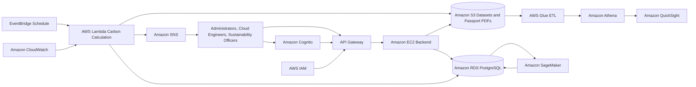

# Cloud Digital Carbon Passport Workflow

## Target Flow

## Operational Workflow

1. Users authenticate through Cognito as administrators, cloud engineers, or sustainability officers.
2. API Gateway accepts authenticated REST requests and forwards them to the backend.
3. The backend serves resources, carbon passports, forecasts, recommendations, alerts, and report metadata.
4. EventBridge triggers scheduled collection and carbon-calculation jobs.
5. Lambda and Glue process utilization, storage, and reporting data into RDS and S3.
6. SageMaker produces forecast and recommendation intelligence from prepared data.
7. Athena and QuickSight query curated data for dashboard analytics.
8. CloudWatch records operational metrics and logs.
9. SNS sends threshold alerts and report notifications.

## Current Local Implementation

The current codebase is a complete local project implementation of the framework:

- The backend calculates sample carbon passport metrics and exposes REST endpoints.
- The frontend presents the passport dashboard, AWS account inventory, architecture view, recommendations, forecasts, analytics, alerts, and settings.
- AWS live reads are limited to read-only infrastructure, billing, and CloudWatch usage views when credentials are configured.
- Deployment-specific AWS resource creation should follow `architecture/AWS_Deployment_Guide.md`.
